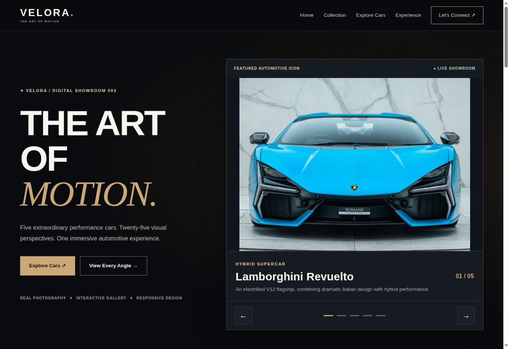

# VELORA Motors

A fictional automotive showroom built with **HTML, CSS and JavaScript**. Explore five cars through category filters, a photo-angle selector, and a fullscreen gallery.

**[Open live showroom](https://ahsanawan-dev.github.io/velora-car-showroom/)** · [Developer portfolio](https://ahsanawan-dev.github.io/3d-portfolio/)

[](https://ahsanawan-dev.github.io/velora-car-showroom/)

## Features

- Five vehicle entries and 25 local photographs.
- Collection filters for hybrids, performance cars, and grand touring.
- Five views per vehicle: front, side, rear, interior, and wheel detail.
- Car selection that updates the photo explorer and vehicle information.
- Fullscreen gallery with previous/next controls and thumbnail selection.
- Responsive navigation and reduced-motion handling.

## Run locally

**New: PHP + MySQL manager** — admin login, car management, draft/publish controls, and a stored enquiry inbox are available in [`manager/`](manager/README.md). Follow its XAMPP guide. This backend runs locally or on PHP hosting; GitHub Pages serves only the static showroom below.

With Git and Python 3 installed:

```bash
git clone https://github.com/ahsanawan-dev/velora-car-showroom.git
cd velora-car-showroom
python -m http.server 8000
```

Open **http://localhost:8000**. If your system uses `python3`, use `python3 -m http.server 8000`. VS Code's Live Server extension also works. There are no npm dependencies or build steps.

## Explore the gallery

1. Use the collection filters to narrow the visible cars.
2. Select a car in the photo explorer, then choose an angle.
3. Open the fullscreen viewer to browse the photographs.

| Input | Action |
| --- | --- |
| Left / Right arrow | Previous / next image while the fullscreen viewer is open |
| Escape | Close the fullscreen viewer |
| Tab / Shift+Tab | Move between interactive controls |
| Enter or Space | Activate a focused button |

## Implementation

Vehicle data lives in the `cars` array in `script.js`. Each entry maps a vehicle to its image folder and five filenames. JavaScript coordinates the selected car, viewing angle, and fullscreen gallery; CSS handles the layout and black-and-gold visual treatment.

| Path | Responsibility |
| --- | --- |
| `index.html` | Page sections, collection cards, explorer, and gallery dialog |
| `style.css` | Layouts, colors, animation, and responsive rules |
| `script.js` | Vehicle data, filtering, photo selection, and keyboard controls |
| `assets/images/` | Photographs grouped by vehicle |
| `docs/preview.jpg` | Screenshot of the live showroom |

## Scope and next steps

The original GitHub Pages demo is a frontend concept, with no booking service, payments, live stock feed, or database. The vehicle viewer uses photographs; it is not a rendered 3D model. The separate [PHP manager](manager/README.md) adds its own database-backed collection and enquiry workflow.

- Check the layouts on more mobile devices and browsers.
- Optimize image delivery and document image sources and reuse permissions.
- Continue extending the PHP and MySQL manager and prepare a hosted backend demo.

## Image credits

Vehicle names belong to their respective manufacturers. VELORA is an independent concept and is not affiliated with them. The photographs are third-party imagery; a complete source and permission record is not yet included. The repository does not grant rights to reuse those images.

## Feedback

[Open an issue](https://github.com/ahsanawan-dev/velora-car-showroom/issues) with the car, selected angle, browser, and steps to reproduce a problem.

Built by [Muhammad Ahsan Awan](https://github.com/ahsanawan-dev).

